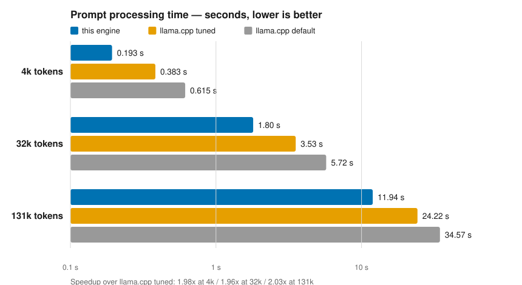
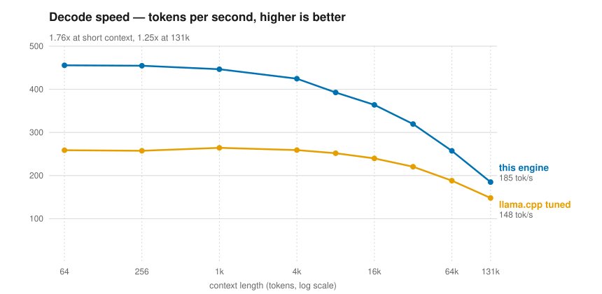

# lfm2-ampere

A CUDA inference engine for [LFM2.5-24B-A2B](https://huggingface.co/LiquidAI/LFM2.5-24B-A2B), written from scratch for one GPU: the RTX 3090 Ti (sm_86). Every kernel is hand-written, and every number here was measured on the card, not estimated.

It processes prompts about twice as fast as llama.cpp tuned for the same job, and decodes about 1.6–1.8x faster at short context, on the same weights and the same hardware.

Independent project. Not affiliated with Liquid AI.

## The numbers

Both engines ran the same GGUF, the same token ids, the same corpus. llama.cpp is shown at its defaults and at its best measured prefill setting (`-ub 4096 -b 4096`). One request per point, best of 2. Raw data in [`bench/`](bench/).

| | this engine | llama.cpp tuned | speedup | llama.cpp default | speedup |
|---|---|---|---|---|---|
| prefill 4k | 0.193 s | 0.383 s | **1.98x** | 0.615 s | 3.18x |
| prefill 32k | 1.80 s | 3.53 s | **1.96x** | 5.72 s | 3.18x |
| prefill 131k | 11.9 s | 24.2 s | **2.03x** | 34.6 s | 2.90x |
| decode, short context | 455.7 tok/s | 258.7 tok/s | **1.76x** | 258.0 tok/s | 1.77x |
| decode, 131k context | 184.9 tok/s | 148.1 tok/s | **1.25x** | 148.6 tok/s | 1.24x |

<picture>
  <source media="(prefers-color-scheme: dark)" srcset="docs/media/prefill_time_dark.svg">
  
</picture>

<picture>
  <source media="(prefers-color-scheme: dark)" srcset="docs/media/decode_speed_dark.svg">
  
</picture>

The model quality is unchanged. Over 126,936 positions of a book-length corpus, the mean next-token loss is **4.3502** against llama.cpp's **4.3503** — the batched prefill does not degrade accuracy anywhere out to the full 131k context. Measured against exact float64 math computed from the weights, this engine is 0.014% off; llama.cpp is 0.220% off the same reference.

## What this is, and what it isn't

It is a single-stream, batch-1, greedy-decode engine for one model in one quantization (Q4_0, with the embeddings in Q6_K), on one 24 GB Ampere card. It reads the model's own GGUF, repacks the weights once into a layout the kernels like, and runs.

It is not a server. There is no request handling, no continuous batching, no tokenizer (the engine takes token ids), and it will not run on anything except sm_86. The CUDA graph and the tile shapes are tuned for the 3090 Ti; Ada and Hopper want different choices.

## How it works

The model is a hybrid: 40 layers, 30 of them short convolutions and 10 attention, with a 64-expert top-4 mixture of experts in every FFN. About 2B of its 24B parameters fire per token. The whole game at batch 1 is streaming 1.47 GB of weights per token from the GPU's memory as efficiently as possible.

What was done for Ampere specifically:

- **int8 tensor cores read Q4_0 weights directly.** The 4-bit nibble layout of Q4_0 already matches the int8 A-fragment layout of `mma.m16n8k32`, so a weight block goes from memory to the tensor core with two logic ops and no dequantization pass. Activations are quantized to Q8_1 on the fly.
- **The int32 accumulator is seeded with a magic constant** (the bit pattern of 1.5 x 2^23) so the finished integer sum reads out as a float for free. Ampere runs int-to-float conversion at 1/8 rate, and without this trick the conversion, not the math, would bound every GEMM.
- **Copies use `cp.async` from every thread.** Ampere has no TMA (that is Hopper), so a warp-specialized producer/consumer GEMM was built and measured: 8–25% slower than the all-threads multistage pipeline, because a few warps cannot issue enough async copies to feed the tensor cores. The negative result is kept in the tree.
- **A decode step is one CUDA graph of 343 nodes.** Launch overhead is about 0.6 us per node and very real at 2.3 ms per token; the graph replays the whole step in one call.
- **Reductions were un-single-blocked.** A kernel with one block cannot hide HBM latency no matter how many threads it has. The router went from one block to 64 (25.7 us to 4.5 us), the argmax from one to 125 (145 us to 6 us). The router carried 1.4% of the bytes and was the most expensive kernel in the engine until this was fixed.
- **Long-context attention uses split-K.** Each query's context is sliced across blocks with a deterministic two-stage combine, so a 131k scan uses the whole GPU instead of one block per head.
- **Prefill scores attention in int8** with an exact fp16 window kept near the diagonal and at the attention sink. The int8 error on real activations is smaller than the rounding the next quantization step already applies.
- **RMSNorm is folded into the kernel that produces its input**, using the scale-invariance of Q8_1, so 80 normalization kernels disappear from the step.
- **The MoE FFN is one grouped GEMM.** The chunk's expert assignments are counted, planned into 64-slot tiles per expert, and scattered in a fixed order, so results are deterministic at any chunk size.

Before any of this, the engine ran prompts one decode step per token: a 131k prompt took 526 s. Batched prefill does it in 11.9 s.

## Quickstart

Requirements: an RTX 30-series or A-series card with 24 GB (sm_86), CUDA 12.x toolkit, Python 3 with numpy, and about 30 GB of free disk (13.6 GB for the model, ~13 GB for the repacked weights).

Download the model (the QAD checkpoint, not the plain one — the engine's numbers are for this file):

```bash
mkdir -p models && cd models
huggingface-cli download LiquidAI/LFM2.5-24B-A2B-GGUF LFM2.5-24B-A2B-Q4_0.gguf
cd ..
```

Build the engine:

```bash
source ./setenv.sh
make engine
```

Repack the weights into the planar layout, then prove the repack lost nothing:

```bash
python3 tools/repack.py
python3 tools/verify_pack.py
```

Run it. The engine takes token ids as arguments, or a little-endian int32 blob via `LK_PROMPT_BIN`:

```bash
LK_NGEN=64 ./build/engine gen 40 319 3280
```

Run the kernel tests:

```bash
make test-all      # quant dots, norm, rope, conv, router vs independent references
make test-prefill  # every prefill kernel vs the decode kernel or a float64 reference
```

## Reproducing the comparison

The llama.cpp side was b10342, flash attention on, fp16 KV cache, one slot, measured on a second identical RTX 3090 Ti while the engine ran on the first. The harnesses feed both engines the same token ids from `ref/corpus_regular.bin`. The oracle tools link a llama.cpp build directly; point `LLAMA_DIR` at one before `make oracle-tools`.

```bash
# this engine, across prompt lengths
python3 tools/engsweep.py --out /tmp/engine.json

# llama.cpp, defaults and tuned
python3 tools/llamasrv.py --tag default --out /tmp/llama_default.json
python3 tools/llamasrv.py --flags "-ub 4096 -b 4096" --tag tuned --out /tmp/llama_tuned.json
```

The published raw results are in `bench/*_2026-10-22.json`. The accuracy gates:

```bash
make gate-c2      # teacher-forced loss vs exact float64 math from the weights
python3 tools/nllcurve.py   # per-position NLL vs llama.cpp out to 131k
```

## What didn't work

Not everything paid off, and the failures are in the tree with their measurements:

- **Speculative decoding: rejected before building it.** Measuring the real expert routing showed consecutive tokens barely share experts. The draft pass would re-read experts the verify pass already evicted, and lm_head costs the same at every position. A net loss, proven with one afternoon of measurement.
- **A persistent megakernel: built, bit-identical, slower.** Deleting the 343 kernel boundaries replaces them with threadfences that cost more than they save on Ampere.
- **Warp-specialized GEMM: built, slower** (see above).
- Several fusions that measured 0.2–1.6% slower and were switched off, each kept behind a flag so the negative result stays reproducible.

## Layout

```
src/            engine.cu, kernels.cu/.cuh, prefill.cu/.cuh, quant.cuh, tensor_table.h
tests/          kernel tests and benchmark harnesses
tools/          repack, verification, gates, bench drivers, chart generator
bench/          raw published results (2026-10-22)
ref/            corpora, fixtures, oracle references
docs/         the deep dive: architecture, diagnosis, review
```

[`docs/ARCHITECTURE.md`](docs/ARCHITECTURE.md) is the full technical record: the byte model, every kernel, every decision with its measurement and verdict. [`docs/DIAGNOSIS.md`](docs/DIAGNOSIS.md) is the debugging journal that found the original parity bug, and [`docs/REVIEW-2026-10-21.md`](docs/REVIEW-2026-10-21.md) is an external review of the design.

## Credits

- [Liquid AI](https://www.liquid.ai/) for the LFM2.5 model. The weights are not in this repo; download them under the [LFM license](https://huggingface.co/LiquidAI/LFM2.5-24B-A2B-GGUF/blob/main/LICENSE).
- [llama.cpp](https://github.com/ggml-org/llama.cpp) as the baseline and the correctness oracle for this checkpoint.
- The test corpora: *War and Peace* (Project Gutenberg #2600, public domain) for `corpus_regular.bin`; docs from `syv-ai/HyperQwen` and vLLM (Apache-2.0) for `corpus_code.bin`.

This repository ships without a license file; all rights reserved.
